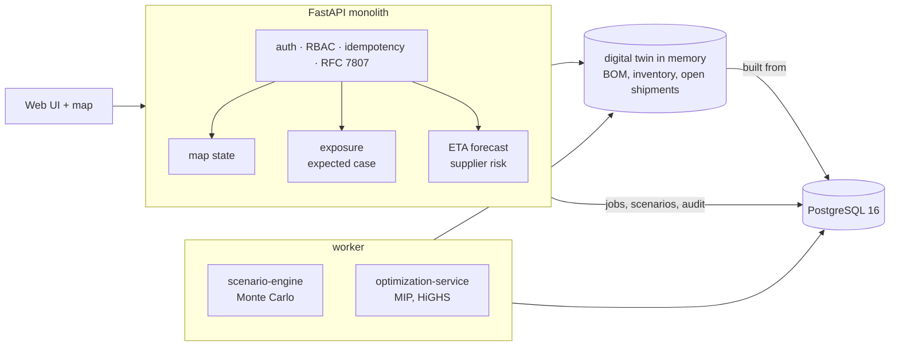

# Supply-Chain Disruption Digital Twin

A model of a manufacturer's inbound supply network that answers three questions when something breaks: what is affected, what will it
cost, and what is the cheapest way out. It follows a port slowdown through delayed shipments, the bill of materials and plant
inventories to lost sales, simulates a thousand futures, and solves for a recovery plan.

Built from blueprint 3 of an "Enterprise SaaS + AI" build book as a **vertical slice**: the demo scenario end to end, with the
platform parts real and the rest listed under [Not built](#not-built-and-why).

**Port and city locations are real. Every company, part, order and dollar is synthetic.**

## Run it

```bash
docker compose up --build        # migrates, seeds (about 30 s), serves http://localhost:8103/ui/
docker compose run --rm test     # 17 tests against a throwaway database
```

Open http://localhost:8103/ui/ and press **Run all steps**, or `make bootstrap demo`. API docs at `/docs`.
Demo tokens (local only): `acme-planner-demo`, `acme-viewer-demo`, `acme-admin-demo`.

## The demo, step by step

1. The network map: 12 ports, 10 plants, 28 warehouses, 38,696 inbound shipments worth $523M, 1,090 single-sourced components.
2. Inject a what-if: Shanghai loses 70% of its capacity for 21 days. A queue model gives each shipment a delay by the day it reaches the port (up to 13.1 days, and the queue takes two months to drain).
3. Exposure: 5,122 shipments and 1,224 components delayed (207 with no second source); following the BOM down, 36 finished products lose sales; expected lost revenue $2.58M.
4. Each plant is simulated day by day for 12 weeks. First stock-outs appear around day 33 to 40. One shipment's arrival forecast (promised 20 Nov, predicted 5 Dec) and its supplier's risk are shown.
5. A job runs 1,000 futures with uncertain depth, length and transit times: median lost revenue $3.3M, one in ten above $36M.
6. A mixed-integer model (78,437 variables) picks 46 shipments to fly, 5 second-source buys and 17 warehouse transfers.
7. Three plans judged by the same simulator: do nothing costs $1.39M, flying the most delayed shipments $5.39M, the optimized plan $0.22M.

## Architecture



| Piece | How it works |
|---|---|
| Delay model | Fluid first-in-first-out queue at the port: work arrives at the port's utilisation, is served at reduced capacity during the cut and full capacity after. |
| Graph propagation | The multi-level BOM is exploded to purchased components, giving a requirement matrix per plant; a delayed component maps to every finished product that contains it. |
| Simulator | Daily inventory balance per plant and component; production is limited by the scarcest component, shared components are rationed in proportion; a finished-goods buffer absorbs the first losses. Vectorised over futures. |
| Monte Carlo | Samples cut depth, cut length and per-shipment transit noise; reruns the same futures without the cut for comparison. |
| Optimizer | MIP over 3-day periods: binary "fly this shipment", continuous second-source buys (capacity, lead time, not behind the same port) and warehouse-reserve pulls; minimises lost margin + freight + premium + transfer cost. The plan is scored by the simulator, not by its own objective. |
| Forecasts | Gradient-boosted quantile models for arrival time; calibrated classifier for supplier lateness. Both registered with their held-out scores and baselines. |
| Platform | Row-level security per tenant, Postgres job queue with retries, idempotent writes, hash-chained audit log, `/metrics`. |

## Data model

`migrations/002_supply_chain.sql` follows the blueprint (suppliers, facilities, parts, bom_edges, supplier_parts, purchase_orders,
po_lines, shipments, inventory_positions, disruption_events, scenarios, scenario_results); additions are marked `(+)`.

## API

| Method | Endpoint | Purpose |
|---|---|---|
| GET | `/v1/map/state` | Network state for the map |
| POST | `/v1/scenarios` | Create a disruption scenario |
| GET | `/v1/exposure?event={id}` | Impacted shipments, components, products, facilities, revenue |
| POST | `/v1/scenarios/{id}:run` | 202 + job: Monte Carlo |
| POST | `/v1/recovery-plans` | 202 + job: optimize and compare plans |
| GET | `/v1/shipments/{id}/eta` | Predicted arrival with an 80% interval |
| GET | `/v1/suppliers/{id}/risk` | Delay risk, drivers, dependency |

Contract: [`docs/openapi.json`](docs/openapi.json).

## Measured

[`docs/evaluation.md`](docs/evaluation.md) (`python -m sc.evaluate`) and [`docs/performance.md`](docs/performance.md).

| Component | Result | Baseline |
|---|---|---|
| Arrival forecast, most recent 180 days held out | 1.42 days mean error; 80% interval covers 79% | lane median 1.94; promised date 1.93 |
| Supplier lateness | AUC 0.827, Brier 0.086 | overall late rate: Brier 0.114 |
| Recovery, 70% for 21 days (net cost) | $0.22M | do nothing $1.41M; fly the most delayed $5.38M |
| Recovery, 70% for 42 days | $1.41M | do nothing $41.2M; fly the most delayed $7.75M |
| Undisturbed network | $0 lost in every future | by construction |

## The hardest tradeoff

The optimizer plans for the expected delay, and the expected case is not what happens. In the demo its plan costs $0.22M against $5.39M
for flying everything, but in the worst tenth of the Monte Carlo futures it still loses about $21M of revenue where the expensive plan
loses about $8M. A cheap plan carries less insurance. Solving over scenarios (a stochastic program) would price that tradeoff properly
and was not built: it multiplies the model by the number of scenarios. Instead the plan is scored on the simulated futures and the
tail is shown next to the saving, so a planner sees both.

A second, smaller one: the optimizer uses 3-day periods while the simulator is daily. Receipts are assigned to the first period that
starts on or after arrival; before that fix the optimizer believed it had removed all losses and the simulator still found $0.77M.

## Threat model (summary)

| Threat | Mitigation here | Gap |
|---|---|---|
| One tenant reading another's network | RLS on tenant tables; orders and shipments are only reachable through a tenant-owned supplier; twin cache keyed by tenant | Cache is process memory |
| Planner-only actions by a viewer | Deny-by-default role permissions; tests cover the matrix | Static demo tokens, no SSO |
| Replayed scenario or plan requests | `Idempotency-Key`, jobs written in the same transaction | No rate limit on job creation |
| Silent change of what was decided | Scenarios, simulations and plans are audited with engine and solver status in a hash chain | No external anchor |

## Not built, and why

- **Live event feeds** (weather, vessels, news): the one disruption is injected by hand; the port congestion index is synthetic history.
- **Other disruption types** in the blueprint's library (supplier shutdown, strike, flood, lane closure, quarantine): only port capacity reduction is modelled.
- **PostGIS**: locations are lat/lon columns; no spatial query runs in SQL here.
- **Stochastic or robust optimization**: see the tradeoff above. **Anomaly detection on lead times**: not started.
- **Kafka, Redis, OpenTelemetry, Grafana, Terraform, CI, SSO, a Next.js front end**: not needed to prove the slice; no cloud account used.
- Lost production is lost, not caught up later, and plant-to-plant transfers are not modelled (each component belongs to one plant; reserves sit in regional warehouses).

## Commercial sketch

Buyer: manufacturers, distributors, procurement teams. Pricing shape from the blueprint: tiered by facilities and SKUs plus event-feed
usage, with scenario planning as an enterprise module. The UI's "What is it worth?" panel multiplies the per-event saving by an assumed
number of events per year.

## Layout

```
core/        platform kit: db + RLS, jobs, audit chain, HTTP, scenario runner, load test
sc/          world (generator), twin (queue, simulator, Monte Carlo, optimizer), models, api, seed, evaluate
migrations/  forward-only SQL          web/   UI with Leaflet map, scenario.json, demo.json (recorded run)
tests/       17 tests                  docs/  evaluation.md, performance.md, openapi.json
```
